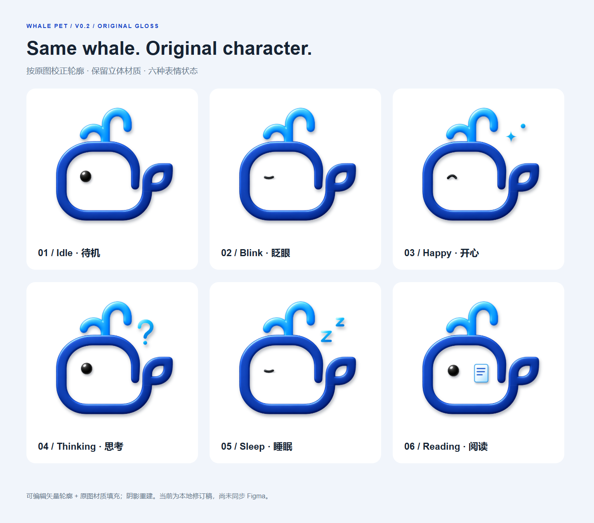

# Whale Pet · 个人主页视觉包

当前版本：**V0.2 原图立体材质版**，2026-10-04 迁入本仓库。开心、思考、睡眠的表情图标已放大 60%。

先打开 [六状态总览](v02-glossy/whale-pet-character-sheet.png) 或 [完整对照预览](v02-glossy/comparison.html)。HTML 可以直接在浏览器本地打开。



## 资源位置

| 位置                                           | 内容与用途                                                                   |
| ---------------------------------------------- | ---------------------------------------------------------------------------- |
| `v02-glossy/`                                  | 最新六状态 SVG / PNG、总览、对照页、轮廓母版、四部分材质、遮罩与原始验证数据 |
| `v02-glossy/whale-pet-glossy-v02.zip`          | 迁移前交付包的原样归档；其中的旧脚本不作为仓库再生成入口                     |
| `reference/whale-original.png`                 | 用户提供的原始 1254 × 1254 图片，已从临时目录永久保存                        |
| `reference/whale-pet-v01-flat.svg`             | 上一版扁平设计，仅用于前后对照                                               |
| `reference/original-brief.txt`                 | 原始讨论材料，留作设计背景；不代表已实现功能                                 |
| [网页资源](../../public/assets/img/whale-pet/) | 六状态无损 WebP、PNG 备用图、资源路径清单                                    |
| [再生成脚本](../../scripts/whale-pet/)         | 已改为仓库相对路径，不依赖 Codex 临时目录                                    |
| [manifest.json](manifest.json)                 | 版本、材质类型、图层、尺寸、六状态文件路径和 SHA-256                         |
| [migration-report.json](migration-report.json) | 原交付包复制完整性核对结果                                                   |
| [animation-plan.md](animation-plan.md)         | 接入 Astro 主页与后续动画方案                                                |

状态名统一为 `idle`、`blink`、`happy`、`thinking`、`sleep`、`reading`。源 SVG、透明 PNG 和 WebP 均以 512 × 512 展示，SVG 的内部坐标为 1254 × 1254。

六张 WebP 总计 **503,144 bytes（约 491 KiB）**，比六张 PNG 的 718,238 bytes 减少 **29.9%**。导出脚本逐像素核对透明度与所有非全透明像素的 RGB；全透明像素的隐藏 RGB 不作比较。

## 当前交付边界

视觉素材和设计工具已迁入仓库。主页现已通过 `WhalePet.astro` 接入轻浮动、眨眼、点击喷水与开心反馈、闲置睡眠。开关与文案位于 `site.pet`；线上更新仍需发布网站。

运行组件使用 [分层几何数据](../../src/data/whale-pet-artwork.json) 与 `public/assets/img/whale-pet/layers/` 中的原图材质，保留本目录母版。`python scripts/whale-pet/export-artwork.py` 可重新导出这套运行资源，只依赖 Python 标准库。

立体外观使用**可编辑矢量轮廓 + 内嵌原图栅格材质**。`body`、`tail`、`spout`、`eye` 分层，附加符号使用 `expression` 图层（仅出现在有符号的状态中）。高光并非全部以矢量渐变重绘，放大清晰度仍受原图约束，柔和阴影由 SVG 滤镜重建。

原始 `validation.json` 中 `reference_mask_iou: 0.998594` 衡量的是轮廓栅格化后与提取遮罩的重合度，不能解释为整张图与原图的视觉相似度。

[现有 Figma 文件](https://www.figma.com/design/aWj8wKmVFVCfLjJfddQwgf) **尚未同步 V0.2**，仍保存此前的扁平设计。本目录中的 V0.2 是当前迁移版本；没有 `.fig`、`.riv` 或骨骼动画文件。需要继续在 Figma 编辑时，可导入本目录 SVG，并以同名 PNG 检查阴影效果。

## 更新网页资源

仅更新 WebP 与 PNG 副本，使用项目现有 Node 24+、Yarn 依赖，无须 Python 或浏览器：

```powershell
yarn node scripts/whale-pet/export-web-assets.mjs
```

资源 URL 从 `/assets/img/whale-pet/manifest.json` 获取，例如 `/assets/img/whale-pet/idle.webp`。此清单使用站点根路径；若未来部署在子路径，组件应通过 `site.base` 拼接基础路径。大体积源文件与归档留在 `design/`，不会进入 Astro 的 `dist/`。

## 重新生成设计稿

通常无需重新描摹。以下流程会覆盖 `v02-glossy/` 中相应的生成文件；先通过 Git 保存当前版本。

1. 使用 Python 3.12，并安装 [requirements.txt](../../scripts/whale-pet/requirements.txt) 中的设计依赖。它们不参与网站构建。
2. 运行轮廓与材质生成器：

   ```powershell
   python scripts/whale-pet/refine-contours.py
   ```

3. 使用本机 Chrome 渲染对照页、总览、六张透明 PNG 和轮廓栅格图：

   ```powershell
   yarn node scripts/whale-pet/build-preview.cjs
   ```

   默认使用 Chrome 通道；自定义浏览器可通过 `WHALE_PET_CHROME_PATH` 指定可执行文件。描摹和预览脚本都支持 `WHALE_PET_OUTPUT_DIR` 指定另一个输出目录，方便比较。

4. 确认视觉后再次运行 `export-web-assets.mjs`，更新网页资源及两份清单，然后运行 `yarn build`。

`comparison-detail.png`、`larger-expression-icons.png`、原始 `validation.json`、ZIP 与迁移报告是本次交付的历史快照，不由上述脚本更新。新轮廓需要另做遮罩验证，不能沿用旧的 IoU 结果。
